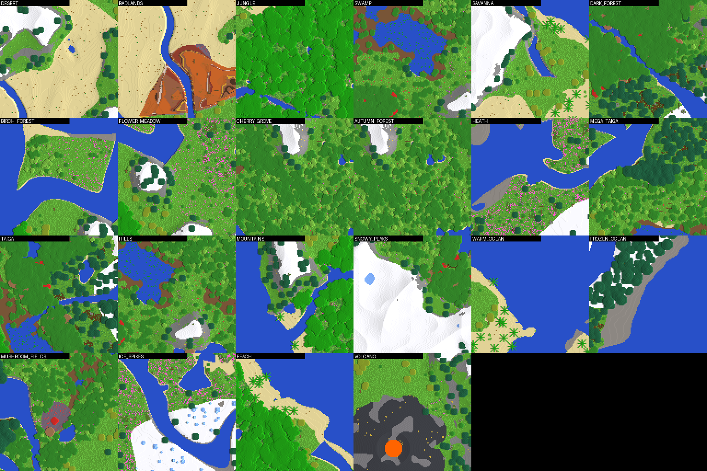

<div align="center">

# ❄️ Norrblock

**A Nordic voxel survival game written in Rust, rendered with Vulkan 1.3.**

[](https://github.com/drak3r-01/Norrcraft/actions/workflows/build.yml)
[](https://github.com/drak3r-01/Norrcraft/actions/workflows/ci.yml)
[](https://github.com/drak3r-01/Norrcraft/releases/latest)
[](https://github.com/drak3r-01/Norrcraft/releases)
[](LICENSE)




[Download](#-download) · [Build from source](#-build-from-source) · [Controls](#-controls) · [Documentation](#-documentation)

</div>

## ✨ Features

- **Infinite procedural world**: 8 biomes, 4 world types, 19 structures, caves, water and lava.
- **Nordic survival**: hunger, cold, stamina, progressive mining with 5 tool tiers, armour, fishing, farming, cooking, 82 items and 70 recipes with an in-game recipe book. Creative mode is also available.
- **Wildlife**: 45+ configurable animals and mobs with animated skeletal rigs.
- **Modern renderer**: Vulkan 1.3 with dynamic rendering, shadows, fluids, bloom, clouds, a day/night cycle, particles and auroras.
- **LAN multiplayer**: up to 8 players, no dedicated server needed (Esc → *Open to LAN*).
- **Moddable**: JSON data files, resource packs, in-game commands.
- **Fast and parallel**: multi-threaded chunk generation, greedy meshing, frustum culling.

## 📦 Download

Grab the archive for your system from the [**latest release**](https://github.com/drak3r-01/Norrcraft/releases/latest), extract it anywhere and run the game from inside its folder.

| Platform | Architecture | Archive | Launch |
|----------|--------------|---------|--------|
| Windows 10/11 | x86-64 | `Norrblock-windows-x64-*.zip` | `norrblock.exe` |
| Windows 11 | ARM64 | `Norrblock-windows-arm64-*.zip` | `norrblock.exe` |
| Linux | x86-64 | `Norrblock-linux-x64-*.tar.gz` | `./norrblock` |
| Linux | ARM64 | `Norrblock-linux-arm64-*.tar.gz` | `./norrblock` |
| macOS (Apple Silicon M1–M4) | ARM64 | `Norrblock-macos-arm64-*.tar.gz` | `./Norrblock.command` |
| macOS (Intel) | x86-64 | `Norrblock-macos-x64-*.tar.gz` | `./Norrblock.command` |

Checksums are published in `SHA256SUMS.txt` next to the archives.

### Requirements

A GPU and an up-to-date driver supporting **Vulkan 1.3** (NVIDIA, AMD, Intel Arc/Xe and recent iGPUs, Apple Silicon through MoltenVK). The Vulkan SDK is *not* needed to play.

### Platform notes

<details>
<summary><b>Windows</b></summary>

Extract the zip and double-click `norrblock.exe`. If SmartScreen warns about an unknown publisher, choose *More info → Run anyway* (the binaries are not code-signed). A "no compatible GPU" message means your graphics driver is too old.
</details>

<details>
<summary><b>Linux</b></summary>

```bash
tar xzf Norrblock-linux-x64-*.tar.gz && cd Norrblock && ./norrblock
```

You need the Vulkan loader and a driver: `sudo apt install libvulkan1 mesa-vulkan-drivers` (Debian/Ubuntu), `sudo dnf install vulkan-loader mesa-vulkan-drivers` (Fedora), or `sudo pacman -S vulkan-icd-loader` plus your GPU driver (Arch). Works on X11 and Wayland.
</details>

<details>
<summary><b>macOS (Apple Silicon and Intel)</b></summary>

Vulkan runs on top of Metal through [MoltenVK](https://github.com/KhronosGroup/MoltenVK), which is bundled as `libMoltenVK.dylib`.

```bash
tar xzf Norrblock-macos-arm64-*.tar.gz && cd Norrblock && ./Norrblock.command
```

The launcher clears the download quarantine flag and points the loader at the bundled MoltenVK. macOS support is **experimental**: it is compiled in CI but has had little testing on real hardware, so please [open an issue](https://github.com/drak3r-01/Norrcraft/issues) if something breaks.
</details>

## 🛠 Build from source

You need [Rust](https://rustup.rs) (stable; `rust-toolchain.toml` pins the channel). Shaders are precompiled to SPIR-V and committed, so no Vulkan SDK or `glslc` is required.

```bash
git clone https://github.com/drak3r-01/Norrcraft.git
cd Norrcraft
```

| System | Command | Result |
|--------|---------|--------|
| Linux / macOS (any architecture) | `scripts/build-unix.sh` | `dist/Norrblock/` |
| Windows (MSVC, PowerShell) | `powershell -ExecutionPolicy Bypass -File scripts\build-windows.ps1` | `dist\Norrblock\` |
| Windows without Rust (Docker cross-compile) | `scripts/build-windows.sh` | `dist/Norrblock/` |
| Quick dev run (any OS) | `cargo run --release -p nb-app` | – |

Prerequisites per system:

- **Windows**: Visual Studio Build Tools 2022 with the *Desktop development with C++* workload.
- **Linux**: a C toolchain (`build-essential`), plus the Vulkan loader and a driver to run.
- **macOS**: Xcode command line tools (`xcode-select --install`) and `brew install molten-vk`.

### Releases and CI

Every push and pull request builds all six targets (Windows, Linux and macOS, x86-64 and ARM64) via [`build.yml`](.github/workflows/build.yml) and uploads them as workflow artifacts. Pushing a version tag publishes an official GitHub release with all packages and checksums:

```bash
git tag v0.2.0 && git push origin v0.2.0
```

[`ci.yml`](.github/workflows/ci.yml) runs `rustfmt`, `clippy` and the full test suite on Linux and Windows.

## 🎮 Controls

Keys are physical QWERTY positions (on AZERTY keyboards, W = Z and A = Q). All bindings can be changed in *Settings → Controls*.

| Action | Key |
|--------|-----|
| Move | `W` `A` `S` `D` |
| Jump (double-tap to fly in creative) | `Space` |
| Sprint / descend while flying | `Left Ctrl` / `Left Shift` |
| Break / place | Left / right click |
| Hotbar | `1`–`9` or mouse wheel |
| Inventory and crafting | `E` |
| Chat / commands | `T` or `/` |
| Third-person view | `F5` |
| Pause, LAN hosting | `Esc` |

Cheat commands (worlds created with *Allow Cheats*): `/help`.

## 🧱 Architecture

A Cargo workspace of focused crates, with no GPU dependency outside `nb-gfx`:

| Crate | Role |
|-------|------|
| `nb-core` | exact `java.util.Random`, math, chunk positions, errors |
| `nb-data` | blocks, mobs, items, settings, resource packs (JSON formats) |
| `nb-world` | noise, biomes, generation, chunks, lighting, async loading, saves |
| `nb-mesh` | greedy meshing, ambient occlusion, multi-threaded scheduler, culling |
| `nb-ecs` | entities, player, physics, AI, survival, inventory, crafting, commands |
| `nb-anim`, `nb-particles`, `nb-audio` | skeletal animation, particles, sound |
| `nb-net` | LAN protocol over TCP, UDP discovery |
| `nb-gfx` | Vulkan 1.3 renderer |
| `nb-ui` | widgets, HUD, inventory, chat, screens |
| `nb-game` | game states, fixed 60 Hz loop, input |
| `nb-app` | the `norrblock` binary: window, renderer driver, headless mode |

## 📚 Documentation

Most design documents are written in French:
[Architecture](docs/ARCHITECTURE.md) · [Survival guide](docs/SURVIE.md) · [Crafting](docs/CRAFT.md) · [World generation](docs/WORLDGEN.md) · [Structures](docs/STRUCTURES.md) · [Fauna](docs/FAUNE.md) · [LAN multiplayer](docs/LAN.md) · [Animation](docs/ANIMATION.md) · [Particles](docs/particles.md) · [Audio](docs/AUDIO.md) · [Performance](docs/PERF.md) · [Detailed French README](docs/README.fr.md)

## 🤝 Contributing

Issues and pull requests are welcome. Before submitting, run:

```bash
cargo fmt --all && cargo clippy --workspace --all-targets -- -D warnings && cargo test --workspace
```

## 📄 License

[MIT](LICENSE) © 2026 drak3r-01
