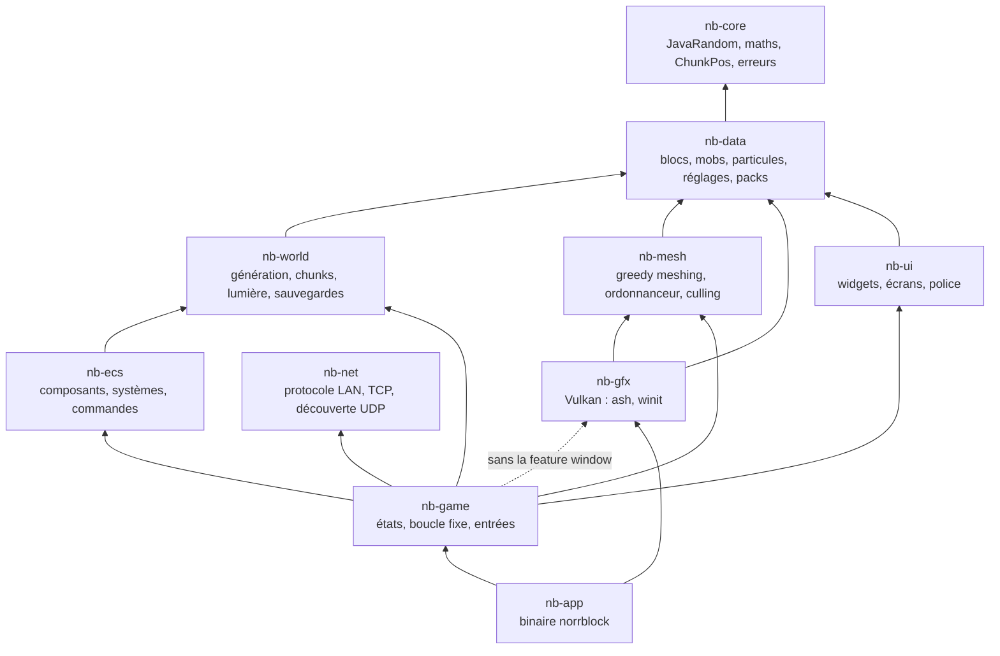

# Architecture de Norrblock (Rust)

Vue d'ensemble pour qui reprend le code. Les comportements détaillés sont dans
`docs/spec/*.md` (une spec par crate) ; les contrats partagés dans `docs/spec/contrats.md`.

## 1. Graphe de dépendances



Règles (sens unique, vérifiées par les `Cargo.toml`) :

* `nb-core` ← `nb-data` ← `nb-world` ← `nb-ecs` ← `nb-game` ← `nb-app`.
* `nb-mesh` est pur CPU (dépend de `nb-core`/`nb-data`) : `nb-game` l'alimente avec les chunks
  de `nb-world` via les traits `ChunkSource` / `BiomeSource`.
* `nb-gfx` ne voit jamais `nb-world` ni l'ECS : il reçoit une `FrameInput` (caméra, horloge,
  mobs, particules, bloc visé…) et des commandes de ressources (maillages, atlas, modèles).
  C'est le seul crate qui touche `ash`. `nb-game` n'utilise que ses parties pures (caméra,
  ciel, `FrameInput`) sans la feature `window`.
* `nb-ui` est pur CPU : chaque écran produit une `DrawList` (sommets + lots texture/scissor)
  rendue par `nb_gfx::ui_pass`.
* Données embarquées dans l'exécutable : `assets/blocks.json`, `particles.json`,
  `mobs_defaults.json`, `mob_geometry.json`, textures de l'interface, nuages, particules,
  icône, shaders SPIR-V précompilés (`crates/nb-gfx/shaders/spv`, `ui/`). Lus à l'exécution :
  `resource_packs/` et `saves/`.

| Crate | Modules principaux |
|---|---|
| `nb-core` | `random` (port exact de `java.util.Random`), `math` (index de chunk, floors) |
| `nb-data` | `blocks`, `mobs` (`MobRegistry`, `mobs.json`), `particles`, `settings` (`settings.json`), `keys` (codes GLFW), `pack` |
| `nb-world` | `noise`, `biome`, `generator`, `chunk`, `light`, `manager` (`ChunkManager`, threads), `storage` (`.nbc`), `save` (`world.json`), `world` |
| `nb-mesh` | `mesher` (greedy, AO, lumière locale), `light`, `neighborhood` (3×3 snapshots), `scheduler` (`MeshScheduler`, threads), `culling` (quadtree + frustum), `highlight`, `vertex` |
| `nb-ecs` | `world` (entités), `components`, `schedule`/`sim` (ordre des systèmes), `player`, `physics`, `ai`, `spawn`, `health`, `inventory`, `particles`, `command`, `javafmt` |
| `nb-net` | `wire` (lecture/écriture bornées), `proto` (messages), `transport` (`NetServer`/`NetClient`, fils par connexion), `discovery` (`Beacon`/`Scanner`), `names` |
| `nb-gfx` | `vk/` (contexte, scène, pipelines, ressources), `window/` (surface, swapchain), `atlas`, `packs`, `mob_model`, `jem`, `sky`, `camera`, `frame`, `ui_pass` |
| `nb-ui` | `widgets`, `font` (stb_easy_font), `draw` (`DrawList`), `hud`, `inventory`, `chat`, `screens/` (menus, monde, réglages, packs, mobs), `textures` |
| `nb-game` | `game` (`Game` : état complet), `state`, `fixed_step`, `input`, `chat`, `chunks` (pont monde → maillage), `render` (`RenderView`), `screens`/`ui` (`NbUi`), `net/` (hôte, client, recherche de parties) et `game/lan.rs` (partie LAN, voir `docs/LAN.md`) |
| `nb-app` | `main` (arguments, boucle winit, mode hors écran), `driver` (pilote commun fenêtre/hors écran), `keymap` (winit → GLFW), `script` (entrées simulées des tests) |

## 2. Boucle principale

`nb-app` reproduit `GameLoop` + `Main` du Java. Avec une fenêtre (`winit`, contrôle `Poll`) :

```
RedrawRequested → Running::frame()
  frame = now − last  (borné à 0,25 s)          FixedStep (nb-game)
  n = ticks dus à 60 Hz ; n × Game::update(1/60) :
     1. InputManager::update (actions, case, delta souris)
     2. horloge jour/nuit (tous les états)
     3. chat (ouverture / validation → commandes, avant l'ECS)
     4. redimensionnement (aspect caméra)
     5. état courant (seul PLAYING fait tourner l'ECS : PlayerInput, Physics, PassiveAI,
        AggressiveAI, MobSpawn, Health ; particules ; spawn)
     6. ChunkManager::update(position caméra)   (chargements / déchargements)
     7. remaillage (MeshScheduler::update sur les chunks actifs triés)
  Driver::apply_requests : réglages graphiques, pack, modèles de mobs ; puis demandes de
     fenêtre (capture du curseur, plein écran, taille, quitter)
  Driver::apply_meshes : MeshAction::Upload / Remove → SceneRenderer
  Driver::render :
     Game::draw_ui() → DrawList (écran + chat) → UiFrame
     état avec monde : Game::render_view() → FrameInput → Renderer::render_world(…, overlay UI)
     sinon             → Renderer::render_ui (fond de terre + UI)
  InputManager::end_frame (molette, clics)
```

Les événements winit (clavier converti en codes GLFW par `keymap`, souris, molette, texte)
alimentent l'`InputManager` de `nb-game` entre deux frames. À la fermeture : sauvegarde du
monde nommé, arrêt des threads, destruction GPU (ordre : UI, renderer, fenêtre).

Mode `--headless` : même pilote (`Driver`) sur un `OffscreenRenderer` sans surface, un tick
par frame ; `--script` rejoue des entrées et prend des captures PNG (outillage de test).

## 3. Threads

| Thread | Nombre | Rôle | Communication |
|---|---|---|---|
| principal | 1 | événements winit, logique (`Game`, ECS, UI), enregistrement et soumission Vulkan, présentation | — |
| `nb-chunkgen-i` | max(1, cœurs/2) | chargement depuis le disque ou génération d'un chunk (`WorldGenerator`, une copie par thread) | file `crossbeam` de `ChunkPos` ; résultat inséré dans la table des chunks actifs (`RwLock<HashMap>`) |
| `nb-light-i` | max(1, cœurs/2) | calcul de lumière d'un chunk (ciel + BFS, halo de 2 blocs) | file de `ChunkPos` ; drapeaux du chunk + compteur d'éditions (course corrigée) |
| `nb-mesh-i` | max(1, cœurs/2) | maillage d'un chunk depuis un voisinage 3×3 de snapshots | file de tâches → file de `MeshResult` (avec numéro de génération), relevée par le thread principal |

Un échec dans un thread de travail (panique) est rattrapé et journalisé ; le thread
continue. `Game::shutdown` arrête les files et attend les threads.

## 4. Flux monde → maillage → GPU

```
ChunkManager::update(pos joueur)               nb-world, thread principal
  ├─ chunks hors rayon : déchargés (réécrits sur disque : saves/<monde>/chunks/*.nbc)
  └─ chunks manquants : ChunkPos → nb-chunkgen-i
         FileChunkStorage::load  ou  WorldGenerator::generate (identique au Java)
         → Chunk (Arc) dans la table active → ChunkPos → nb-light-i → lumière, drapeaux

nb_game::chunks (WorldChunks : ChunkSource, WorldBiomes : BiomeSource)
MeshScheduler::update(chunks actifs triés)     nb-mesh, thread principal
  ├─ chunk prêt (généré, éclairé, voisins présents) et sale → snapshot 3×3 → nb-mesh-i
  │     mesher : lumière locale, greedy meshing par tranches, AO, fluides, croix, nénuphar
  │     → Vec<ChunkVertex> (36 octets/sommet)
  └─ résultats de la génération courante → MeshAction::Upload(pos, mesh) / Remove(pos)
        (un résultat vide garde l'ancien maillage, comme le Java)

Driver::apply_meshes → SceneRenderer::upload_chunk_mesh  nb-gfx
  buffer de sommets par chunk ; l'ancien buffer est détruit après les frames en vol

SceneRenderer::record_frame (chaque frame)
  quadtree (positions triées) + frustum caméra / lumière
  1. ombre (si LOW/HIGH ; OFF : carte effacée à 1.0)
  2. scène A : terrain opaque + requêtes d'occlusion (résultats lus avec une frame de retard)
  3. scène B1 : fluides (profondeur en lecture seule)
  4. scène B2 : mobs + particules
  5. bloom : 10 passes de flou ping-pong en demi-résolution
  6. composite pp.frag : distorsion, bloom, chaleur, brouillard, ciel, nuages, aurores, ACES
  7. overlay : contour du bloc visé puis interface nb-ui (ui_pass) → présentation
```

Un changement de pack (`PlatformRequest::ReloadResourcePack`) recharge l'atlas, les icônes et
les modèles de mobs puis invalide tous les maillages (nouvelle génération) ; un changement de
monde fait de même et vide les maillages.

## 5. Fichiers lus et écrits à l'exécution

Relatifs au dossier courant (comme le Java) :

* `saves/settings.json`, `saves/mobs.json`, `saves/<monde>/world.json`,
  `saves/<monde>/chunks/c_<cx>_<cz>.nbc` (option `--saves <dossier>` pour un autre dossier) ;
* `resource_packs/` cherché dans `./`, `../`, puis à côté de l'exécutable et dans son parent
  (`nb_gfx::find_packs_root`, chemin affiché au démarrage).

## 6. Tests et outillage

* `cargo test --workspace` : tests unitaires et d'intégration CPU (vecteurs de référence
  produits par le Java pour le bruit, les biomes, les chunks et les buffers de maillage).
* Tests GPU (`nb-gfx/tests/render.rs`, `ui_pass`, `nb-app/driver`) : sautés sans Vulkan ;
  sous Docker avec lavapipe via `crates/nb-gfx/scripts/vk-docker.sh`.
* `crates/nb-app/scripts/e2e.sh` : scénario complet hors écran (captures) puis fenêtré (Xvfb),
  couches de validation actives.
* `scripts/test-dist-linux.sh` / `scripts/test-dist-windows-wine.sh` : même scénario lancé
  depuis le paquet distribuable (Linux, ou le vrai `norrblock.exe` sous Wine).
* Parité fonctionnelle : `docs/PARITE.md` ; écarts : `docs/DIFFERENCES.md`.
